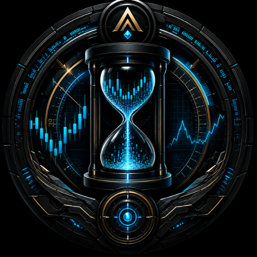

  

# Axiom Chronos Vector

> **Know the Data. Know the Risk. Know the Truth.**

Axiom Chronos Vector is a native Android application for vectorized financial market backtesting, built entirely in Kotlin and designed to run its computational workload directly on your device.

**No accounts. No telemetry. No cloud dependencies. No ads.**

## What It Is
Most backtesting environments either run remotely or depend on a desktop Python ecosystem. Chronos takes a different approach: it is a self-contained mobile research environment that performs the complete workflow — from market-data ingestion through execution simulation and quantitative analysis — entirely on the Android device.

Its execution model is **vectorized rather than traditionally event-driven**. Signal generation and risk-rule application operate across price vectors, making it fast and lightweight enough to run complex simulations locally.

## Validation (No Guessing)
We do not guess if the math works. Chronos is validated with:
1. **175 Unit Tests:** Every metric and strategy has been verified with negative-control tests.
2. **VectorBT Cross-Check:** On one dataset (BTCUSDT 1h, 2 years, EMA 20/50, long only, no stops), Chronos's executor produced 169 trades whose entry and exit bars were identical to `vectorbt`'s when both were driven by the same signals. Chronos's EMA signals also matched an independent Python calculation on every bar. *Stops, gaps, short positions, trailing stops, the other indicators, and stock/commodity data have not yet been cross-checked.*

## What It Does

### The Integrity Engine
Bad data leads to bad backtests. Before any backtest is presented, the data is audited.
- Checks for missing candles, timestamp gaps, and duplicates.
- Trading-day aware: It understands weekends, US market holidays, and CME futures maintenance breaks.
- Bars dropped by market-rule cleaning (zero-volume or flat bars) are explicitly disclosed in the app and on the generated PDF reports.
- Adjusts the **Validity Rating** (High, Moderate, Low, Untrustworthy) based on volatility-weighted data completeness. If the data has a problem, Chronos reports the problem.

### Backtesting Engine
- Simulates entries, exits, fees, and realistic slippage.
- Long and Short positions.
- Stop Loss, Take Profit, and ATR Trailing Stops.
- Realistic gapped-stop fills (simulates fills at the bar open if price gaps past your stop).
- Total-loss guard: Positions are closed if equity drops below zero. Note: Leverage and margin-call prices are not modeled.

### Strategy Library
- EMA Cross, MACD, RSI, ADX, Bollinger Breakouts, Money Flow Index (MFI), Keltner Channels, ATR Breakout, ROC, and Stochastic.
- Includes a 200-period EMA regime filter.

### Quantitative Intelligence
- **Performance:** Total Return, Max Drawdown, Win Rate, Profit Factor, Expectancy, Trade Count.
- **Risk-Adjusted:** Sharpe, Sortino, Calmar, and Kelly Criterion.
- **Benchmark:** Alpha, Beta, and Pearson Correlation (appear in the PDF export, measured against the buy-and-hold of the same asset).

### Probability Cloud & Sequence Risk
Chronos uses Monte Carlo permutation reshuffling to generate a **Probability Cloud**. It shows the median, 5th, and 95th percentile worst-case drawdowns. It does not predict the future; it exposes how dependent your result is on the sequence of historical trades. (Memory-capped to prevent crashes on high-frequency strategies).

## What Chronos Does *Not* Do
Chronos is a **research and simulation environment**, not an execution platform.
- **No Live Trading:** It does not connect to brokerage accounts or execute live trades.
- **No Predictions:** It does not predict future prices or guarantee future performance.
- **No Financial Advice:** It is a research instrument, not a trading oracle.
- **No Cloud Processing:** It does not send your strategies or trade data to a server.

## Execution Assumptions
Because backtests are simulations, Chronos is explicit about its assumptions:
- Entries and signal exits fill at the close of the signal bar.
- Stops fill at the stop level, or at the bar's open if the bar gaps through it.
- If stop-loss and take-profit are both reachable inside one candle, the stop-loss is assumed to hit first.
- Fee and slippage are charged on each side of every trade. (Default fees are 0.1% for Crypto, 0.05% for Commodities, 0.02% for Stocks, plus 0.05% slippage).
- Each trade uses 100% of equity. No leverage or margin interest is modeled.
- Alpha, Beta, and Correlation are measured against buy-and-hold of the *same asset*, not a market index.

## Data & Privacy
Market data is fetched directly from public market data providers (Binance for Crypto, Yahoo Finance for Stocks/Commodities). Note that these providers will see your IP address and the requested tickers to return the data. Downloaded data is cached locally in memory on your device and purged when the session is cleared.

## Architecture & Tech Stack
Chronos follows an MVVM structure with Clean Architecture around the computational core (Jetpack Compose, Coroutines/StateFlow, OkHttp, MPAndroidChart, Google Play Billing). 

## Reporting
Chronos provides a full trade-execution record and supports local export via the Android Storage Access Framework. The PDF includes the exact strategy parameters, data source, execution assumptions, dropped-bars disclosure, and up to 200 recent trades.
