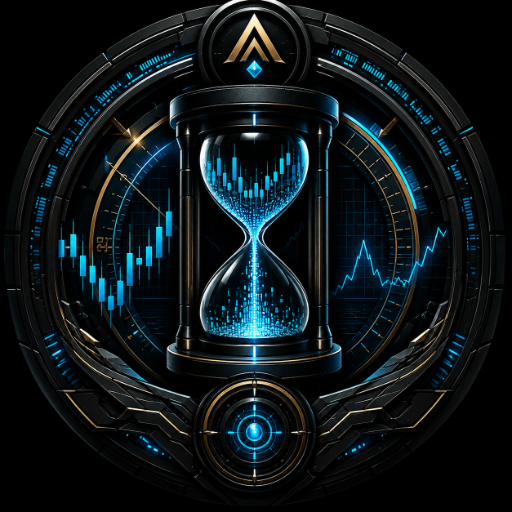

  

Axiom Chronos Vector
Know the Data. Know the Risk. Know the Truth.

Axiom Chronos Vector is a native Android application for vectorized financial market backtesting, built entirely in Kotlin and designed to run its computational workload directly on your device.

The only network dependency is the on-demand retrieval of public market data. Strategy computation, analysis, caching, and results remain local to the device.

No accounts. No telemetry. No cloud dependencies. No ads.

What It Is
Most backtesting environments either run remotely or depend on a desktop Python ecosystem. Chronos takes a different approach: it is a self-contained mobile research environment that performs the complete workflow — from market-data ingestion through execution simulation and quantitative analysis — entirely on the Android device.

Its execution model is vectorized rather than traditionally event-driven. Signal generation and risk-rule application operate across price vectors, making it fast and lightweight enough to run complex simulations locally.

Validation (No Guessing)
We do not guess if the math works. Chronos is validated with:

140+ Unit Tests: Every metric, edge case, and strategy has been verified with negative-control tests.

VectorBT Cross-Check: In a head-to-head test against Python's vectorbt across Crypto, Stocks, and Commodities, the actual Kotlin engine generated a 100% match on trade signals (e.g., 169/169 trades on BTCUSDT).

Realistic Execution: On gapped markets, Chronos intentionally diverges from standard libraries by simulating realistic stop-loss fills at the gap open, rather than assuming a perfect fill at the stop price.

What It Does
The Integrity Engine
Bad data leads to bad backtests. Before any backtest is presented, the data is audited.

Checks for missing candles, timestamp gaps, and duplicates.

Trading-day aware: It understands weekends, US market holidays, and CME futures maintenance breaks.

Adjusts the Validity Rating (High, Moderate, Low, Untrustworthy) based on volatility-weighted data completeness. If the data has a problem, Chronos reports the problem.

Backtesting Engine
Simulates entries, exits, fees, and realistic slippage.

Long and Short positions.

Stop Loss, Take Profit, and ATR Trailing Stops.

Realistic gapped-stop fills.

Simulated margin-call / liquidation logic.

Strategy Library
EMA Cross, MACD, RSI, ADX, Bollinger Breakouts, Money Flow Index (MFI), Keltner Channels, ATR Breakout, ROC, and Stochastic.

Includes a 200-period EMA regime filter.

Quantitative Intelligence
Performance: Total Return, Max Drawdown, Win Rate, Profit Factor, Expectancy, Trade Count.

Risk-Adjusted: Sharpe, Sortino, Calmar, and Kelly Criterion.

Benchmark: Tactical Alpha, Beta, and Pearson Correlation (measured against the buy-and-hold of the same asset).

Probability Cloud & Sequence Risk
Chronos uses Monte Carlo permutation reshuffling to generate a Probability Cloud. It shows the median, 5th, and 95th percentile worst-case drawdowns. It does not predict the future; it exposes how dependent your result is on the sequence of historical trades. (Memory-capped to prevent crashes on high-frequency strategies).

What Chronos Does Not Do
Chronos is a research and simulation environment, not an execution platform.

No Live Trading: It does not connect to brokerage accounts or execute live trades.

No Predictions: It does not predict future prices or guarantee future performance.

No Financial Advice: It is a research instrument, not a trading oracle.

No Cloud Processing: It does not send your strategies or trade data to a server.

Architecture
Chronos follows an MVVM structure with Clean Architecture around the computational core:

text
UI / Jetpack Compose
        ↓
LaboratoryViewModel
        ↓
Data Providers → Integrity Engine
        ↓
Vectorized Execution Engine
        ↓
Metrics & Quantitative Intelligence
        ↓
Probability Cloud / Results
Core packages:

core.data — Binance/Yahoo market-data provider abstraction

core.engine — vectorized execution and quantitative metrics

core.integrity — data auditing and validation

core.export — native PDF reporting

Technology Stack
Kotlin 2.0+

Jetpack Compose / Material 3

Coroutines / StateFlow

OkHttp

MPAndroidChart

Android 8.0+ (Min SDK 26)

Google Play Billing

Reporting
Chronos provides a full trade-execution record and supports local export, including native PDF report generation. The PDF includes the exact strategy parameters, data source, execution assumptions, and trade log, so any result can be reproduced.

Availability
Axiom Chronos Vector is currently in public testing. When production-ready, it will be distributed exclusively as an Android application through the Google Play Store.

## Reporting
Chronos provides a full trade-execution record and supports local export, including native PDF report generation. The PDF includes the exact strategy parameters, data source, execution assumptions, and trade log, so any result can be reproduced.
