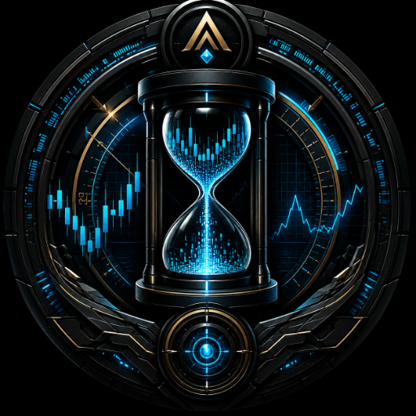

  

# Axiom Chronos Vector

**Know the Data. Know the Risk. Know the Truth.**

Axiom Chronos Vector is a native Android application for vectorized financial market backtesting. Built entirely in Kotlin, it runs completely on your device.

The only network dependency is the on-demand retrieval of public market data. Strategy computation, analysis, caching, and results remain local to the device. 

**No accounts. No telemetry. No cloud dependencies. No ads.**

Chronos is designed as a standalone, privacy-first research tool. You are not the product; your data stays on your hardware.

## What It Is
Chronos is a research environment that performs the complete workflow—from market-data ingestion through execution simulation and quantitative analysis—on your Android device. 

Its execution model is **vectorized rather than traditionally event-driven**. Signal generation and risk-rule application operate across price vectors, making it fast and lightweight enough to run complex simulations locally.

## What It Does

### Market Data & The Integrity Engine
- **Crypto:** Binance public OHLCV data.
- **Stocks & Commodities:** Yahoo Finance market data.
- **Data Auditing:** Before any backtest is presented, the data is audited by the **Integrity Engine**. It checks for missing candles, timestamp gaps, and duplicates. If the data quality is poor (e.g., a provider missed days of data), Chronos adjusts the final Validity Rating and tells you exactly what is wrong. 

### Backtesting Engine
- Simulates entries, exits, fees, and slippage.
- Supports Long and Short positions.
- Stop Loss and Take Profit.
- Volatility-adjusted ATR Trailing Stops.
- Simulated margin-call / liquidation logic.

### Strategy Library
- EMA Cross, MACD, RSI, ADX, Bollinger Breakouts, Money Flow Index (MFI), Keltner Channels, ATR Breakout, ROC, and Stochastic.
- Includes a 200-period EMA regime filter.

### Quantitative Intelligence
- **Performance:** Total Return, Max Drawdown, Win Rate, Profit Factor, Expectancy, Trade Count.
- **Risk-Adjusted:** Sharpe Ratio, Sortino Ratio, Calmar Ratio, Kelly Criterion.
- **Benchmark Relative:** Tactical Alpha, Beta, and Pearson Correlation (measured against the buy-and-hold of the same asset).

### Probability Cloud & Sequence Risk
Historical trades can produce different equity paths depending on their order. Chronos uses Monte Carlo permutation reshuffling to generate a **Probability Cloud**, showing you the median, 5th, and 95th percentile worst-case drawdowns. It does not predict future prices; it exposes sequence risk.

## What Chronos Does *Not* Do
- **No Live Trading:** It does not connect to brokerage accounts, manage wallets, or execute live trades.
- **No Predictions:** It does not predict future prices or guarantee future performance.
- **No Financial Advice:** It is a research instrument, not a trading oracle.
- **No Cloud Processing:** It does not send your strategies or trade data to a server. 

## Execution Assumptions
Because backtests are simulations, Chronos is explicit about its assumptions:
- Entries and signal exits fill at the close of the signal bar.
- Stops fill at the stop level, or at the bar's open if the bar gaps through it. 
- If stop-loss and take-profit are both reachable inside one candle, the stop-loss is assumed to hit first.
- Fee and slippage are charged on each side of every trade.
- Each trade uses 100% of equity. No leverage or margin interest is modeled.
- Alpha, Beta, and Correlation are measured against buy-and-hold of the *same asset*, not a market index.

## Validation
We do not guess if the math works. 
- **140+ Unit Tests:** Every metric, edge case, and strategy has been verified with negative-control tests.
- **VectorBT Benchmark:** In a head-to-head test against Python's `vectorbt` across Crypto, Stocks, and Commodities, Chronos generated a **100% match on trade signals**. On gapped markets, Chronos intentionally underperforms standard libraries because it simulates realistic stop-loss fills at the gap open, rather than assuming a perfect fill at the stop price.

## Reporting
Chronos provides a full trade-execution record and supports local export, including native PDF report generation. The PDF includes the exact strategy parameters, data source, execution assumptions, and trade log, so any result can be reproduced.
